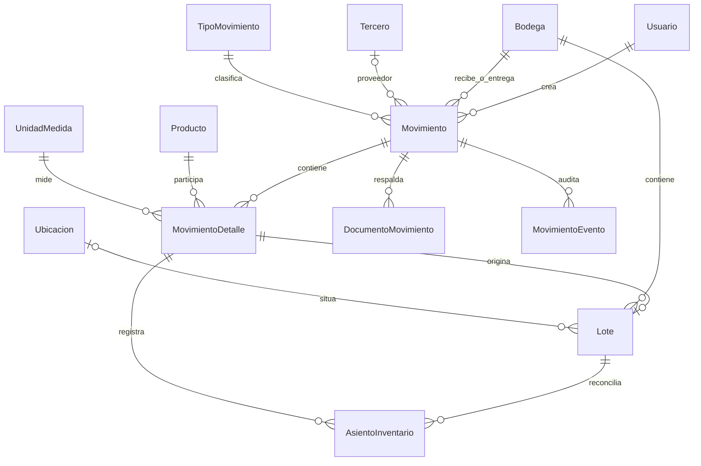

# Sprint 6 — propuesta revisable, NO aplicada

## Diagnóstico y alcance de esta entrega

Se inspeccionaron Git, Prisma, servicios, rutas, componentes y SQL antes de modificar archivos. Se conservaron los cambios locales previos del Detalle del producto. La principal `sistema_inventario` conserva `rol` y `usuarios`: auditoría de estructura, registros, secuencias y `.env` sin cambios (4 roles, 1 usuario). La aislada tiene 15 tablas de negocio y `_prisma_migrations`; solo `000_baseline` y `001_catalogos_terceros` están aplicadas. No hay movimientos, detalles, lotes, ubicaciones, documentos, ajustes ni aperturas instalados. El esquema activo coincide con la aislada.

Los archivos `backend/database/schema.sql` y `funciones_vistas.sql` contienen propuestas anteriores de movimientos, ubicaciones, lotes, consumos y devoluciones. No están instalados. Se reutilizan sus nombres y conceptos compatibles, no sus scripts completos ni sus funciones PEPS. Esos archivos contienen operaciones de otras fases: NO ejecutarlos para este sprint. No se encontraron formatos originales de Entradas o Salidas en el repositorio ni archivos coincidentes accesibles en Downloads; se utilizaron los campos confirmados del prompt y la imagen proporcionada.

Esta entrega prepara modelos, SQL, contratos y pantallas. **No implementa todavía persistencia operativa de movimientos.** Los endpoints de negocio responden 503 y los botones de guardar/confirmar están bloqueados. Tener archivos SQL y contratos no equivale a haber probado transacciones, concurrencia o saldos reales. Se necesita autorización para migrar la aislada y continuar la implementación y validación.

## Respaldo verificado

Archivo privado, ignorado por Git: `.local-backups/sprint6/2026-11-19T20-27-34-086Z/database.dump`.

- Base: `sistema_inventario_sprint5_test`.
- Tamaño: 67 655 bytes.
- SHA-256: `29362298c5925c034c036573f26b2904e263dd49bc20726b2b2a2313fb0c3ea0`.
- Snapshot consistente, identidad del clúster comprobada y archivo decodificado con `pg_restore` sin ejecutar SQL. No se restauró una base, ni se modificó Docker.
- `verification.json` y `database.dump.sha256` están junto al respaldo. No contiene credenciales en documentación pública; el respaldo se debe conservar privado.

El script `backend/scripts/prepare-sprint6.cjs` realiza únicamente diagnóstico y respaldo de esa base; no migra ni crea aperturas. No repetir respaldos como parte del arranque normal.

## Modelos y relaciones

`schema.prisma` es la propuesta completa y validada con Prisma 6. El esquema activo permanece intacto. No se genera ni sustituye su cliente Prisma.

| Modelo nuevo | Propósito |
|---|---|
| Ubicacion | Nivel opcional dentro de una Bodega existente |
| TipoMovimiento | Catálogo configurable de dirección y reglas documentales; sin filas institucionales inventadas; política no aprobada por defecto |
| Movimiento | Número único, dirección, borrador/pendiente/confirmado/cancelado, fecha, bodega, tercero, responsables, referencias, idempotencia y versión |
| MovimientoDetalle | Producto y unidad existentes, cantidad, cantidad solicitada, costo de entrada opcional, subtotal exacto, lote/vencimiento y fotografía de nombres al confirmar |
| Lote | Recepción interna por detalle, código físico opcional, producto, bodega, ubicación y proyección reconciliable del saldo |
| AsientoInventario | Libro inmutable de cantidades firmadas por detalle y lote |
| DocumentoMovimiento | Referencia documental y metadatos opcionales de almacenamiento; sin binarios ni archivos simulados |
| MovimientoEvento | Acciones, actor JWT y fecha; historial append-only |

Se reutilizan Usuario, Producto, UnidadMedida, Bodega y Tercero; no se duplica Proveedor ni se agrega stock editable a Producto. Un lote técnico por recepción no implica inventar un lote físico: `codigo_lote` puede ser nulo. No se fuerza un costo cero cuando se desconoce: queda nulo. Posición, clase declarada y proyecto son campos distintos; clase declarada NO se transforma en `ClaseCoa`.



## Migración y consistencia propuestas

Única migración nueva: `migrations/002_movimientos/migration.sql`. Es aditiva: ocho tablas nuevas, índices, claves, restricciones y funciones/triggers propuestos. Incluye BEGIN/COMMIT para evitar una instalación estructural parcial. No contiene DROP, TRUNCATE, semillas ni aperturas. No recrea el baseline ni altera tablas de catálogos existentes. `constraints.sql` está incorporado al final de la migración: NO aplicarlo también por separado. Mantener el historial y las sumas de comprobación de las dos migraciones previas.

Propuesta de confirmación en `lwi_s6_confirmar`:

1. Verificar actor, política explícitamente aprobada, bodega, proveedor/documentos aplicables y líneas válidas.
2. Bloquear el encabezado con FOR UPDATE. Una segunda confirmación devuelve el mismo movimiento sin repetir asientos.
3. Bloquear producto+bodega mediante advisory locks en orden de producto para serializar retiros; actualizar saldo con condición `cantidad_disponible >= cantidad`.
4. Registrar lote/asiento de entrada o asiento negativo de salida en la misma transacción, sin costo de salida inventado.
5. Congelar código, nombre y unidad; registrar actor/fecha/evento; conciliar saldos y cantidades por restricciones diferidas antes del commit.

Una excepción revierte toda la transacción. Los borradores no afectan saldos. Encabezados/documentos/detalles confirmados y libro/eventos quedan protegidos contra edición o borrado. La función SQL de confirmación no tiene permiso EXECUTE público. Sus permisos de ejecución y el usuario de aplicación requieren revisión antes de activarla.

**Este SQL no fue instalado, ejecutado ni probado concurrentemente.** Su comportamiento es una propuesta para ensayar después de la autorización, no una garantía operativa ya verificada. Deben probarse deadlocks/reintentos, rollback, reconciliación, inmutabilidad, referencias de lote/ubicación y metadatos de políticas/aprobación en PostgreSQL real. La transición de PENDIENTE y la aprobación todavía requieren funciones/reglas específicas; la protección actual falla cerrada, sin aprobación automática.

La selección explícita de lote de salida es una propuesta de trazabilidad física; no fija valoración PEPS/FIFO. FIFO permanece como alternativa a validar. No se habilitan compensaciones ni reversiones en la API; se reserva `movimiento_origen_id` para una operación compensatoria trazable con política posterior. APERTURA está contemplada en el modelo pero su confirmación está expresamente bloqueada: no se registraron existencias iniciales.

## Pantallas y servicios preparados

Rutas: `/entradas`, `/entradas/nueva`, `/entradas/:movementId`, `/salidas`, `/salidas/nueva`, `/salidas/:movementId`. Reutilizan Home, sidebar, header, ProtectedRoute, CatalogFeedback, catálogos, servicios JWT y LanguageContext.

- Listados con búsqueda, fecha, estado, proveedor/solicitante y bodega; controles de paginación. Mientras no hay persistencia habilitada se informa «listado no disponible», no un falso listado vacío. El filtro de tipo espera un catálogo aprobado.
- Formularios de entrada y salida: referencias institucionales, documentos, proveedor real, bodega real, responsable autenticado, productos reales seleccionables y líneas múltiples. Tipos de entrada mostrados como propuestas, no como configuración aprobada. Clase/posición/proyecto se conservan separados.
- Cantidades por unidad y subtotales/costos con escalado BigInt (3 decimales de cantidad, 6 de costo, 9 de subtotal), sin suma monetaria por punto flotante. No se suman indiscriminadamente cajas, unidades y galones. Total desconocido si falta un costo; sin costo/valoración de salida.
- Stock no se presenta como cero: permanece indisponible hasta la migración y el servicio real. Guardar y confirmar están deshabilitados; el formulario es temporal y no simula persistencia.
- Plantilla de detalle con encabezado, líneas e historial; no hay registros para mostrar mientras la persistencia esté bloqueada.
- Adjuntos PDF/JPG/PNG: control deshabilitado y contrato de backend que responde 503. Se preparó un detector de firmas y límite de tamaño, no una infraestructura de almacenamiento. Antes de habilitar cargas faltan almacenamiento privado, descarga autorizada, nombre/clave generados por servidor, validación completa del contenido y política de seguridad. No se guardó ningún archivo de usuario.
- Español, inglés y francés, sin traducir nombres propios. Diseño con columnas en escritorio y una columna en móvil; tablas desplazables localmente.

Detalle del producto conserva su pantalla y los mensajes pendientes. Los contratos `/productos/:id/movimientos` y `/productos/:id/existencias` están preparados con bloqueo explícito, sin sustituir los datos actuales por saldos ficticios. La integración con sus pestañas y la comprobación de apertura se completarán después de la migración; `openingRegistered` es desconocido, no falsamente aprobado.

## API: qué responde hoy

Todos los endpoints requieren JWT activo, rol conocido y base aislada verificada. Escritura reservada conservadoramente a Administrador, sin inferir aprobaciones empresariales.

| Endpoint | Estado en esta etapa |
|---|---|
| GET `/api/inventario-movimientos/capacidades` | Implementado, inspección de solo lectura; enabled=false |
| GET `/api/entradas`, `/api/salidas` | Contrato validado, 503 hasta migración y activación |
| GET `/api/entradas/:id`, `/api/salidas/:id` | Contrato validado, 503 |
| POST `/api/entradas`, `/api/salidas` | Zod/JWT/permisos; sin persistencia, 503 |
| PATCH `/api/entradas/:id`, `/api/salidas/:id` | Contrato de borrador, sin implementación de persistencia, 503 |
| POST `/:recurso/:id/confirmar` | Exige confirmación explícita, versión y UUID; bloqueado, 503 |
| POST `/:recurso/:id/adjuntos` | 503, almacenamiento no aprobado |
| GET `/api/productos/:id/existencias`, `/api/productos/:id/movimientos` | 503, sin saldos ni historial fabricados |

No existen endpoints de borrado. La sola presencia de tablas creadas manualmente NO activa servicios. El backend no usa todavía los modelos nuevos ni una política de confirmación. Falta implementar repositorios/transacciones HTTP e idempotencia real comparando UUID + hash canónico + actor; la clave única del modelo y los contratos están preparados, no se declara probada su concurrencia.

Filtros propuestos: buscar, desde, hasta, tipoId, proveedorId, solicitante, bodegaId, estado, pagina, limite. Operación propuesta: typeId, date, warehouseId, responsibleId, supplierId opcional, referencias institucionales, documents, lines e idempotencyKey. Confirmación: confirmed=true, version e idempotencyKey. Se rechazan campos de actor/estado impuestos por cliente, cantidades no positivas, formatos decimales inválidos, fechas imposibles, UUID inválido y líneas duplicadas. La API existente mantiene su límite JSON; revisar el límite por ruta antes de habilitar movimientos de hasta 100 líneas.

## Pruebas realmente ejecutadas

- Propuesta Prisma completa: formato/validación correctos; diff entre archivos generó SQL únicamente. No se ejecutó migrate deploy, db push, reset ni SQL de instalación.
- Backend Sprint 6: 5 pruebas aprobadas sin IO de PostgreSQL: validación, fechas/idempotencia, firmas, inspección estática del SQL y contratos HTTP bloqueados/permisos.
- Perfil principal: 2 regresiones de aislamiento aprobadas desde el directorio backend que requiere esa suite. Una invocación inicial desde la raíz no encontró su configuración; se corrigió el directorio de ejecución, sin modificar `.env`.
- Frontend Sprint 6: 3 pruebas aprobadas: aritmética exacta, mensajes en los tres idiomas y distinción entre backend desactualizado, migración pendiente y falla de red.
- Regresiones DOM existentes: 3 aprobadas; Login, navegación, Usuarios, Perfil, Configuración, catálogo, formularios e idiomas con API simulada.
- Edge: 374 comprobaciones de distribución aprobadas en 320, 768 y 1366 px, tres idiomas, rutas nuevas, selección de producto, cálculo provisional y bloqueo de Guardar/Confirmar; incluye regresiones de pantallas anteriores y alturas de laptop. Se inspeccionaron capturas de referencia generadas. No se afirma prueba física de teléfonos ni zoom manual.
- Revisión focal final: 164 comprobaciones aprobadas en francés a 320 y 1366 px; se corrigió un desbordamiento del control nativo deshabilitado de adjuntos sustituyéndolo por un marcador deshabilitado localizado, sin carga de archivos.
- Build frontend: correcto.

No se ejecutaron aún las pruebas de crear/confirmar entradas, stock, salidas insuficientes, lotes, concurrencia, rollback, trazabilidad persistida o archivos almacenados. Requieren aplicar la migración y completar/activar servicios y políticas. No se repitieron suites que escriben en Sprint 5 para no introducir más registros durante esta preparación.

## Ejecutar y revisar sin migrar

En dos terminales desde la raíz, con la configuración local existente:

```powershell
npm run dev:sprint5 --prefix backend
npm run dev:sprint5 --prefix frontend
```

Abrir `http://localhost:5174/entradas/nueva` y `/salidas/nueva`. Si ya existen procesos en esos puertos, reiniciar el backend para cargar las rutas nuevas y recargar frontend. No cambiar el `.env` principal. No usar el modo habitual del backend para probar movimientos contra la principal.

```powershell
node --test backend/sprint6-preparation.test.cjs
node --test frontend/sprint6.test.mjs
npm run test:sprint4 --prefix frontend
npm run build --prefix frontend
```

Para Edge se reutiliza Playwright del entorno mediante LWI_PLAYWRIGHT_PATH, sin añadir dependencias. Capturas y reportes: `frontend/.responsive-artifacts/` (ignorados). Esquema activo y principal no modificados; verificar de nuevo antes de cualquier futura autorización.

## Próxima autorización y decisiones pendientes

1. Revisar y autorizar exclusivamente `002_movimientos` en `sistema_inventario_sprint5_test`, con el respaldo verificado y sin tocar la principal. Antes del ensayo revisar el SQL propuesto y el historial; no repetir el baseline.
2. Completar servicios de borradores, idempotencia, consultas de saldos/historial y confirmación contra el cliente propuesto; probar PostgreSQL real, transacciones, dobles solicitudes y retiros concurrentes con datos identificados de prueba. La migración por sí sola no activa estas operaciones.
3. Confirmar tipos configurables y documentos por tipo; política de revisión/aprobación/entrega, roles y responsable; significado institucional de posición y clase; unidad/conversiones; selección física de lote, vencimientos y valoración; infraestructura y permisos de adjuntos. No se impone FIFO ni se confirma una salida en su ausencia.
4. Autorizar aperturas de inventario por separado. No se han solicitado ni ejecutado aperturas reales.

Archivos preparados: propuesta Prisma/SQL y este documento; `backend/scripts/prepare-sprint6.cjs`; `backend/src/modules/movements/` y montaje en app; pantalla Movements, servicio/modelo, CSS, traducciones, rutas/navegación y pruebas. La publicación del código fue autorizada en cinco commits; no autoriza aplicar la migración ni modificar bases de datos.

Organización de la publicación autorizada:

1. Mejora el detalle del producto y reutiliza su edición.
2. Prepara modelos y migración revisable del Sprint 6.
3. Agrega contratos protegidos para entradas y salidas.
4. Integra pantallas de entradas y salidas en tres idiomas.
5. Añade pruebas y documentación de la preparación del Sprint 6.
